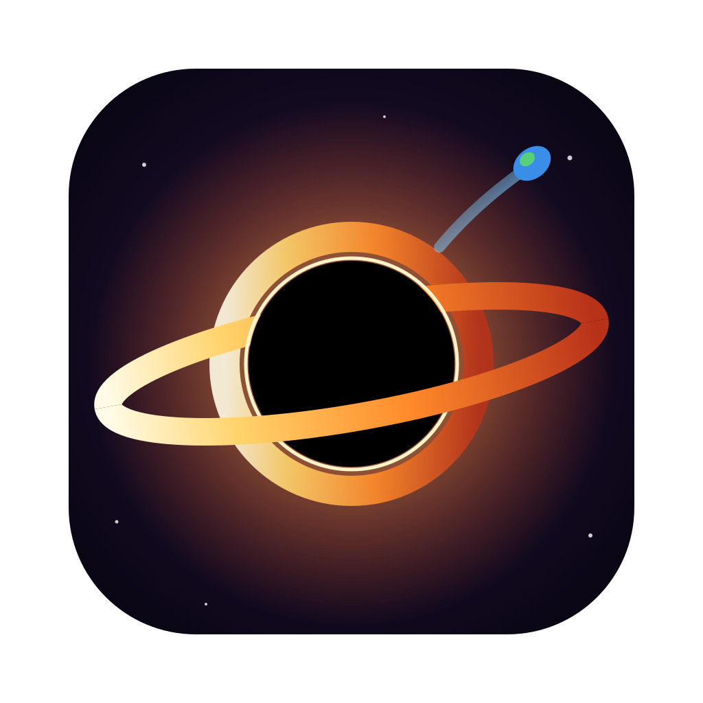
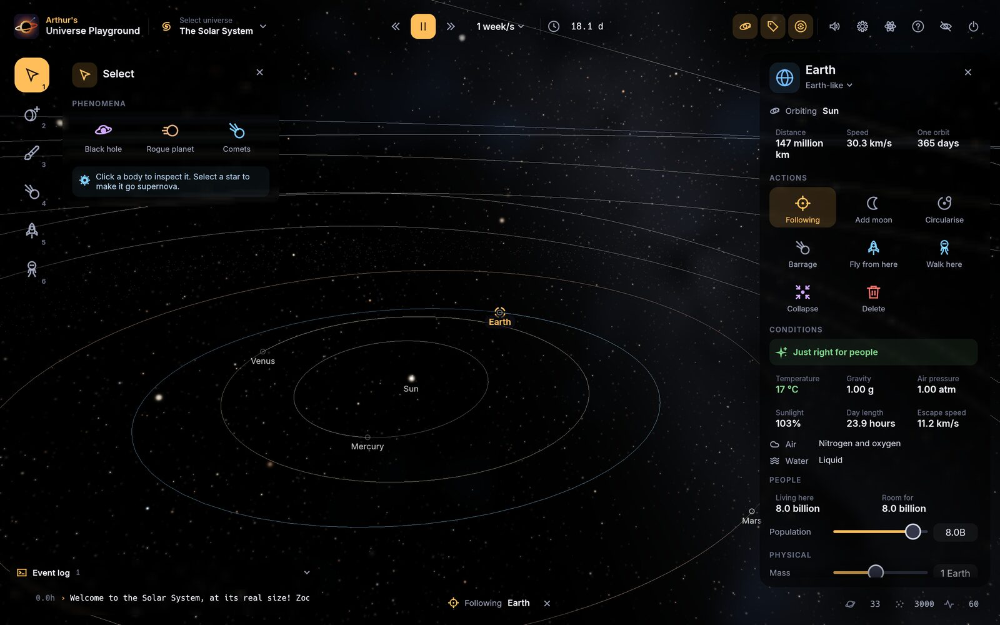
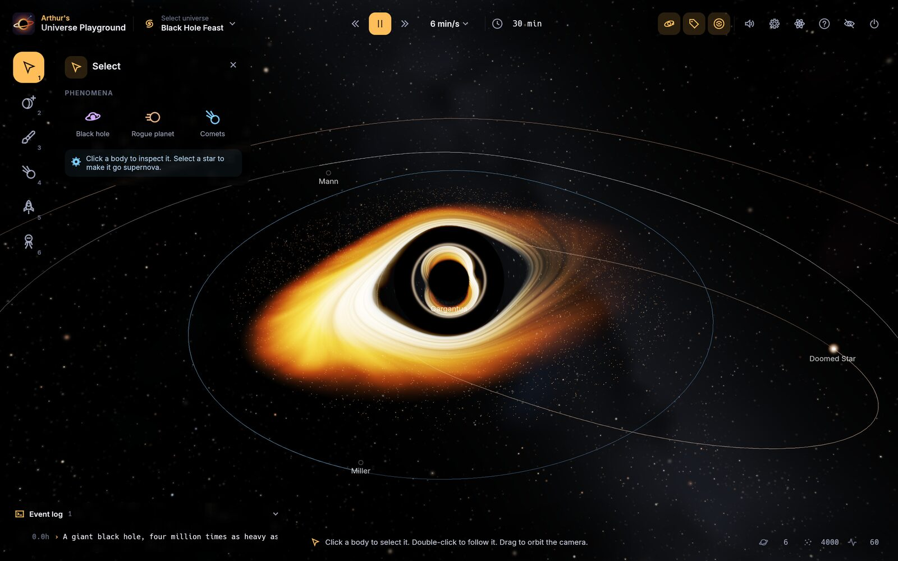
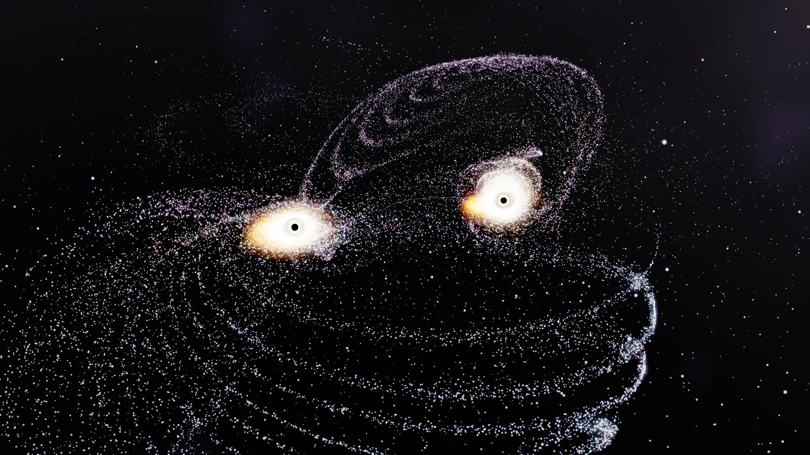
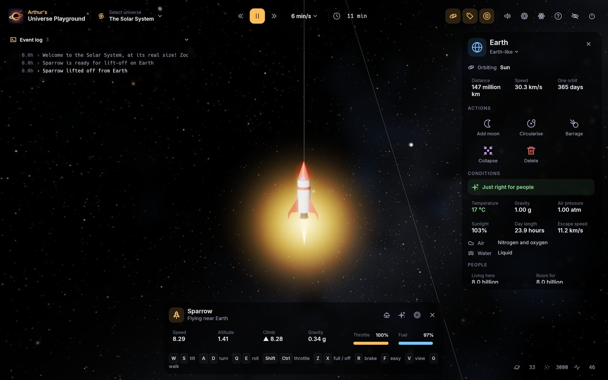
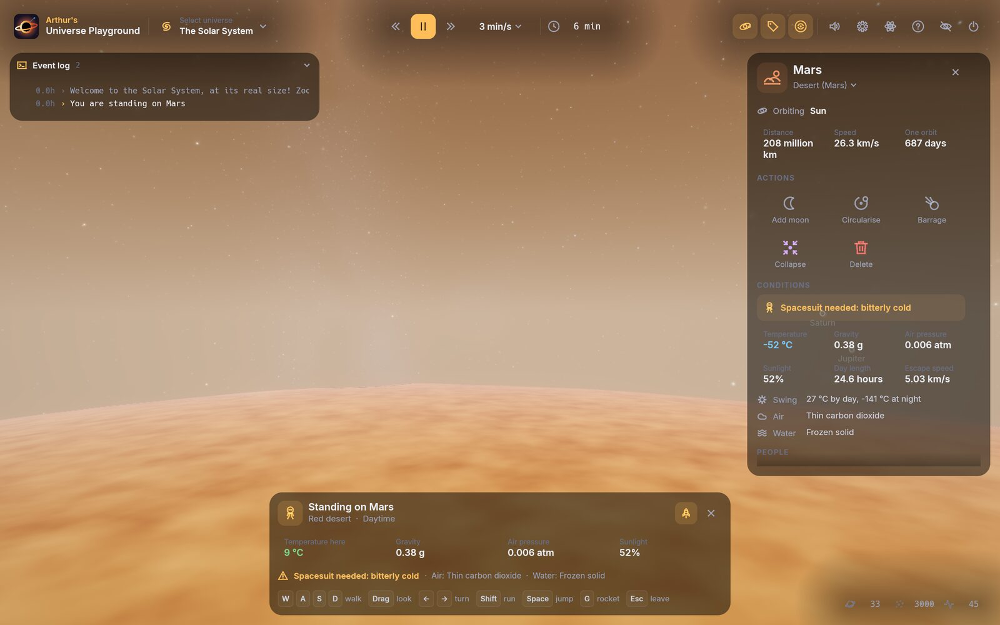
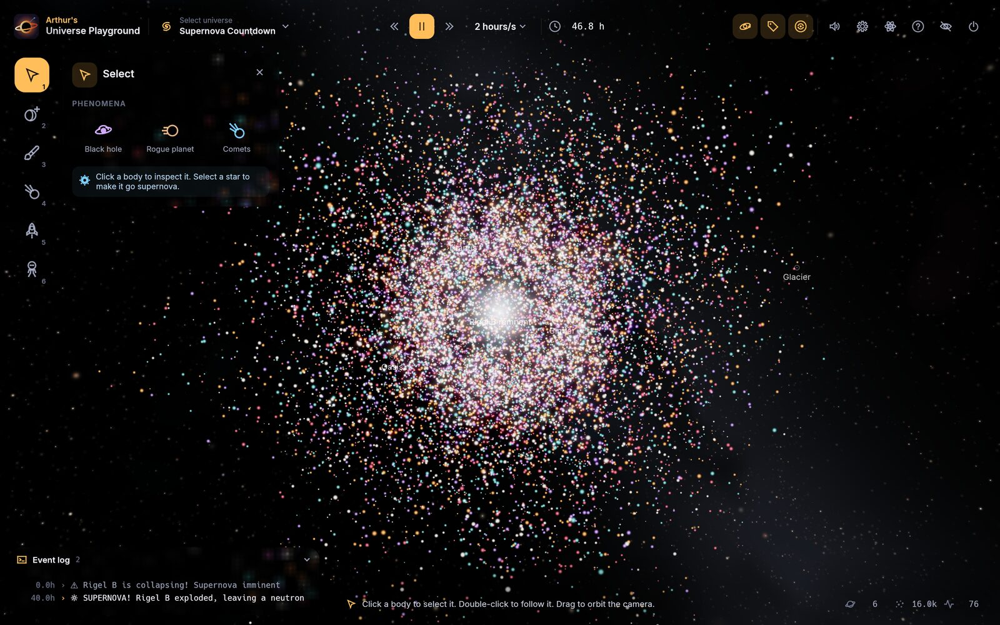
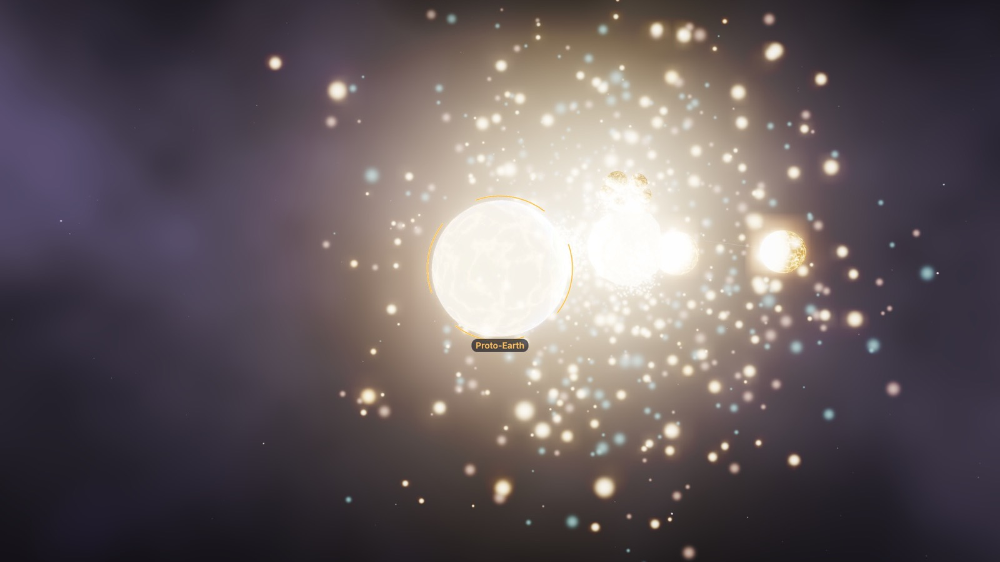

<p align="center">
  
</p>

# 🌍 Arthur's Universe Playground

> **A fully vibe-coded project.** Every line of code, shader, test and doc here was written by an AI coding assistant from plain-language requests, as a test of how far vibe coding can go.



A space sandbox written in **Rust + Vulkan**. Start with the Solar System, then:

- **Terraform planets.** Paint continents, dig oceans, and add lava, ice, forests, sand or craters directly onto planet surfaces.
- **Spawn new worlds.** Click to drop a planet into a circular orbit, or click-and-drag to fling it, with a live predicted trajectory (it turns red if it's going to crash).
- **Smash planets together.** Collisions use an impact-energy model: gentle hits merge (leaving craters and molten scars), harder ones shatter worlds into glowing fragments and debris that can re-accrete.
- **Create your own universe.** Pick a centre (Sun-like star, red dwarf, blue giant, binary, black hole, nothing), the number of planets, moons, belts, rings, gravity strength and chaos.
- **Fly rockets.** Pick one of six rockets, lift off from any solid world and fly under real gravity, with a chase camera or from the cockpit. Land gently, or crash spectacularly. Younger pilots can switch on **Easy flying** for endless fuel and landings that always work.
- **Worlds with people.** Every solid world has a population that grows where conditions are just right, moves away when they turn bad, and sends settlers to empty worlds you make comfortable. Nobody is ever hurt: if a world is destroyed, its people escape in their rockets.
- **Walk on worlds.** Stand on a planet, moon or asteroid, walk over its terrain and jump in its gravity. Climb out of a landed rocket and back in.
- **Save your universes.** Save a universe you've built or painted and load it again later. The game also saves automatically when you close it, so you can carry on where you left off.
- **Hear it.** Rumbling impacts, roaring rocket engines, footsteps, supernovae you feel in your chest, and calm space music. All of it is generated live by the game.
- **See what it's like there.** Every world reports its temperature, gravity, air, sunlight and whether people could live on it.
- **Cosmic phenomena:**
  - **Black holes:** accretion disks with Doppler beaming, gravitational lensing, and tidal disruption ("spaghettification").
  - **Supernovae:** a blast wave that pushes and scorches planets, an expanding nebula, and a neutron-star or black-hole remnant.
  - **Stellar mergers, black-hole mergers and galaxy collisions** with tidal tails.

## Screenshots

| | |
|---|---|
|  |  |
| **Black hole:** lensing, a Doppler-beamed accretion disk and a photon ring | **Galaxy collision:** 68,000 stars, two cores and the tidal tails they fling out |
|  |  |
| **Flying:** lift off from any solid world under real gravity | **Walking:** stand on Mars and see what it's like there |
|  |  |
| **Supernova:** the blast wave, with a neutron star left behind | **Smash planets:** Theia strikes the young Earth a glancing blow, and a piece left in orbit becomes the Moon |

## Download

Grab the latest build from [Releases](https://github.com/jonbp/arthurs-universe-playground/releases/latest):

| Platform | File | Notes |
|---|---|---|
| Windows 10/11 (x64) | `…-windows-x64.zip` | Needs a Vulkan-capable GPU driver (standard with NVIDIA, AMD and Intel drivers). |
| macOS 11+ (Apple Silicon) | `…-macos-arm64.dmg` | MoltenVK is bundled. The app is not notarized: on first launch, right-click the app and choose **Open**. |
| Linux (x86_64) | `…-linux-x86_64.tar.gz` | Needs `libvulkan1`, a Vulkan driver (Mesa or vendor) and `libasound2` for sound (installed on almost every desktop). Run `./install.sh` to add it to your app menu. |

See [CHANGELOG.md](CHANGELOG.md) for what changed in each version.

## Presets

| Preset | What happens |
|---|---|
| The Solar System | To scale: the Sun, 8 planets, Pluto and Charon, Ceres, Vesta, 20 moons, rings and the asteroid belt, each with its real size, mass, orbit, day and tilt |
| Solar System vs Rogue Black Hole | A black hole of ten Suns plows through the Solar System at 60 km/s |
| Theia Impact | A Mars-sized world strikes the proto-Earth a glancing blow, and a piece left in orbit becomes the Moon |
| Head-on Planet Smash | Two worlds collide head-on |
| Binary Star System | Circumbinary planets around two suns |
| Black Hole Feast | A black hole of four million Suns (12 million km across), a doomed star and planets |
| Supernova Countdown | A blue giant explodes after 20 seconds |
| Galaxy Collision | Two ~34k-star galaxies collide (a model, not to scale) |
| Protoplanetary Disk | Planetesimals merge into planets (a model, not to scale) |
| Empty Universe | Build from scratch |

### Everything is its real size

Except for the two models, universes are built to scale from NASA and JPL figures. One unit of length is half the Earth's radius and one unit of time is half an hour, so at the slowest normal speed a second of play is 30 minutes; the speed control reads in time per second (30 min/s, 1 day/s, 1 week/s, up to 10 years/s) and distances, speeds and orbits are shown in km, km/s, days and years. The planets start where they really were on 1 January 2000. The Sun is 109 Earths wide and 23,500 Earth-radii away, which makes planets specks from afar: every world is drawn as a dot with its orbit as a line until you zoom in (double-click to follow one).

Two things are still drawn bigger than life, because the real ones would be too small to find: neutron stars, and black holes lighter than a few hundred thousand Suns. Rockets and astronauts are giants too (a rocket is about 150 km long).

## Controls

| Input | Action |
|---|---|
| Right-drag (or left-drag in Select) | Orbit camera |
| Scroll / pinch | Zoom |
| Middle-drag / Shift+drag | Pan |
| Double-click / `F` | Follow selected body |
| `1`–`6` | Select / Spawn / Terraform / Smash / Fly / Walk tools |
| `Space` | Pause |
| `[` `]` or `-` `+` | Slow down / speed up time |
| `B` | Asteroid barrage at selection |
| `Del` | Delete selection |
| `T` / `L` / `H` | Trails / labels / hide UI |
| `M` | Mute or unmute sound |
| Power button (top right) | Quit (your universe is saved automatically) |
| `F11` | Fullscreen |

Flying (Fly tool, then click a world or press **Launch**):

| Input | Action |
|---|---|
| `W` `S` / `A` `D` / `Q` `E` | Tilt / turn / roll (arrow keys also steer) |
| `Shift` / `Ctrl` | Throttle up / down (`Z` full, `X` off) |
| `R` | Brake assist: hold the nose against your direction of travel |
| `F` | Easy flying: endless fuel, soft landings, self-levelling (also in the Hangar) |
| `V` | Cockpit or outside view (drag to orbit, scroll to zoom) |
| `G` | Get out and walk (when landed) |
| `Enter` | Launch a new rocket after a crash |
| `Esc` | Back to the sandbox |

Walking (Walk tool, then click a rocky world):

| Input | Action |
|---|---|
| `W` `A` `S` `D` | Walk (`Shift` to run) |
| Drag / `←` `→` | Look around / turn |
| `Space` | Jump |
| `G` | Climb into your rocket, or call one |
| `Esc` | Back to the sandbox |

Time slows down automatically when you fly (0.2×) or walk (0.1×), because the worlds are small and everything happens fast; use `[` and `]` to speed up for long trips.

## Settings

The gear button in the top-right bar opens **Settings**, with a tab for each group below. Changes apply straight away and are saved automatically.

- **Display:** fullscreen (`F11`), VSync, and a frame-rate limit (30–240 FPS, or off).
- **Sound:** mute (`M`, or the speaker button), overall volume, effects and music.
- **Resolution scale:** draw the 3D scene at 50–200% of the window resolution. Lower is faster on modest GPUs; above 100% supersamples for smoother edges. The interface always renders at full sharpness.
- **Graphics:** planet detail (Low / Standard / High), exposure, glow, star brightness, gravitational lensing and orbit trails.
- **Interface:** UI size (75–150%), labels, and the bodies / particles / FPS counter.
- **Gameplay:** easy flying.

Settings are stored in `%APPDATA%\Arthur's Universe Playground\settings.json` on Windows, `~/Library/Application Support/Arthur's Universe Playground/settings.json` on macOS, and `~/.config/arthurs-universe-playground/settings.json` on Linux. Set `AUP_SETTINGS` to use a different file.

## Saving

Open the universe menu (top left) and choose **Saved universes…** to save the current universe under a name, or to load or delete a save. Everything is kept: every body and its orbit, painted terrain, rings, the stars of a galaxy, physics settings, the camera and the time speed. When you close the game it saves to an autosave, and **Continue where you left off** in the same menu brings it back.

Saves are `.aup` files in a `saves` folder next to `settings.json` (see above).

## Sound

Every sound is synthesized while the game runs; there are no audio files. Effects get quieter with distance from the camera and are panned left or right to match where they happen. The music is a slow ambient piece that drifts between four chords with bell notes on top and never repeats exactly. Linux builds need the ALSA headers (`sudo apt install libasound2-dev`).

To hear every effect without playing, render a demo WAV: `AUP_DEMO_WAV=demo.wav cargo test --release demo_wav -- --ignored`.

## Updates

On startup the game makes one request to the public GitHub API to see whether a newer release exists. If there is one, a banner offers a **Download** button that opens the file for your platform in your browser. Nothing is downloaded or installed automatically. Run with `--no-update-check`, or set the `AUP_NO_UPDATE_CHECK` environment variable, to turn the check off.

## Building

Requirements: Rust (1.85+) and MoltenVK on macOS.

```sh
brew install rust molten-vk vulkan-loader
cargo run --release
```

To build a self-contained macOS app (MoltenVK embedded, no Vulkan SDK needed to run it):

```sh
./scripts/bundle_macos.sh
open "target/release/bundle/Arthur's Universe Playground.app"
```

The code is portable Vulkan, so it also builds on Linux and Windows with a Vulkan driver installed.

## Releasing

CI (`.github/workflows/ci.yml`) builds and tests on Windows, macOS and Linux for every push and pull request. To cut a release:

1. Bump `version` in `Cargo.toml` and run `cargo build` to update `Cargo.lock`.
2. Move the `[Unreleased]` notes in `CHANGELOG.md` under a new `## [x.y.z] - YYYY-MM-DD` heading and update the compare links.
3. Commit, then tag and push: `git tag vx.y.z && git push origin main vx.y.z`.

`.github/workflows/release.yml` then builds the Windows `.zip` (icon embedded in the `.exe`), the macOS `.dmg` (`.app` with `AppIcon.icns`) and the Linux `.tar.gz` (`.desktop` entry plus icon). It publishes them to a GitHub release, using that version's `CHANGELOG.md` section as the release notes. All icons are rendered from `assets/AppIcon.svg` by `build.rs`.

## How it works

- **Physics** (`src/universe.rs`): f64 N-body gravity with a kick-drift-kick leapfrog integrator and adaptive sub-stepping: each step is as long as the tightest orbit and the fastest approach allow, so the Solar System can run at years per second with Phobos (a 7.7-hour orbit) still on course.
  - `src/units.rs` defines the real-world units and how numbers are worded.
  - Collisions use the specific impact energy Q against a catastrophic-disruption threshold Q*_RD (after Leinhardt & Stewart 2012) to decide between merging, cratering and fragmentation.
  - Black holes disrupt bodies inside the tidal radius r_t = R·(2M/m)^⅓.
  - Supernovae send out a shock front that applies impulses and scorches surfaces.
  - Particles (debris, nebulae, galaxy stars) are test masses pulled by the most massive bodies.
  - The rocket is a massless craft integrated inside the same leapfrog step, so it stays exact at any time warp.
- **Exploring** (`src/explore.rs`, `src/rocket.rs`, `src/terrain.rs`, `src/conditions.rs`):
  - `terrain.rs` is a CPU copy of the planet shader's height function. Both hash the noise lattice with integer maths, which is bit-exact on every GPU, so the ground you stand on is the ground that is drawn.
  - A landed rocket and a walking astronaut are stored in the body's own rotating coordinates, so the ground stays still underfoot while the planet spins and orbits.
  - `conditions.rs` is a small climate model (starlight, albedo, greenhouse warming from air pressure, internal heat), which lands near the real temperatures for the real Solar System.
- **Updates** (`src/update.rs`): a background thread asks the GitHub releases API for the latest tag and compares it with the built version.
- **Rendering** (`src/renderer.rs`, `shaders/`): raw Vulkan through `ash`.
  - Shaders are written in WGSL and compiled to SPIR-V at build time by `naga` (see `build.rs`), so no shader SDK is needed.
  - A reverse-Z HDR scene pass draws instanced procedural planets with vertex displacement, bump-mapped terrain, oceans, clouds and atmospheres, plus the paint texture array. Rings, accretion disks, additive particles and trails follow.
  - A blit-generated mip chain provides bloom. The composite pass applies point-lens gravitational lensing and ACES tonemapping. The egui UI is drawn on top.
  - Rendering is camera-relative, so f32 precision holds even across galaxy-sized scenes.
- **Tests**: `cargo test --release` covers orbit stability, momentum conservation, shattering, supernova remnants, spaghettification, trajectory prediction, the paint brushes, every preset, the tools driven through the input layer, lift-off, landing, crashing, walking and jumping, the climate model, and the update check's version and link handling.

The UI font is [Inter](https://rsms.me/inter/) (SIL Open Font License, see `assets/fonts/Inter-LICENSE.txt`). It is compiled into the binary. UI icons are a custom line-icon set drawn as vectors (`src/icons.rs`): 24-unit grid, round caps, one stroke weight, so they stay sharp at any size and never depend on font glyphs.

Developer flags for automated screenshots: `--preset <name> --focus <body> --zoom <d> --speed <x> --screenshot out.bmp --frames N --hide-ui`. `--fly <body>`, `--walk <body>`, `--rocket <0-5>`, `--cockpit` and `--hold <key,key>` start in flight or on foot, and `--assume-version <x.y.z>` tests the update banner. `--icons` (or `--glyph-test`) shows the whole icon set at large and small sizes (see `--help`).
